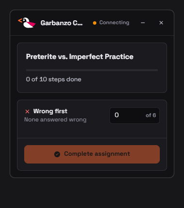
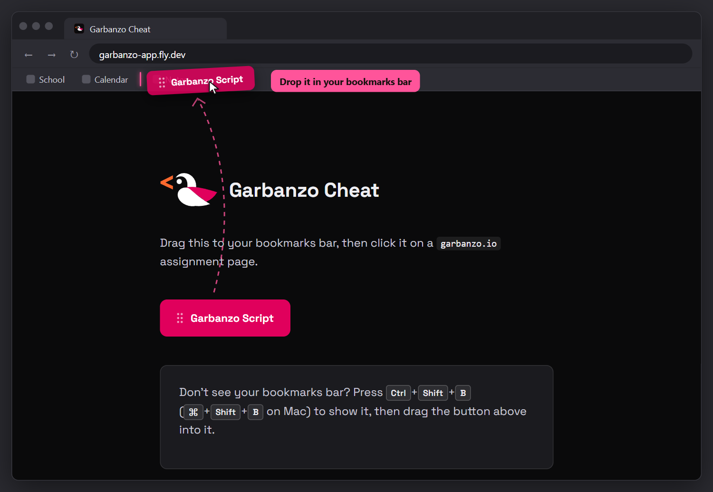

# Garbanzo Cheat

Completes garbanzo.io assignments for you.



## Setup

Go to **https://garbanzo-app.fly.dev** and drag the **Garbanzo Script** button into your bookmarks bar.



Or make a bookmark yourself and paste this as the URL:

```text
javascript:(function(){if(window.__garbanzoQaGuiLoaded){window.dispatchEvent(new CustomEvent('garbanzo-qa-toggle'));return;}var b="https://garbanzo-app.fly.dev";var s=document.createElement('script');s.src=b+'/public/loader.js';s.onerror=function(){alert('could not reach the relay at '+b);};document.body.appendChild(s);})();
```

## Usage

1. Open an assignment on garbanzo.io.
2. Click the bookmark.
3. Once it says **Live**, press **Complete assignment**.

**Wrong first** sets how many questions get answered wrong once, so your score doesn't look perfect.

## Problems?

Press **Copy debug report** on the error and send it to a dev in the [Hackemos Discord](https://hackemos.com/discord).
